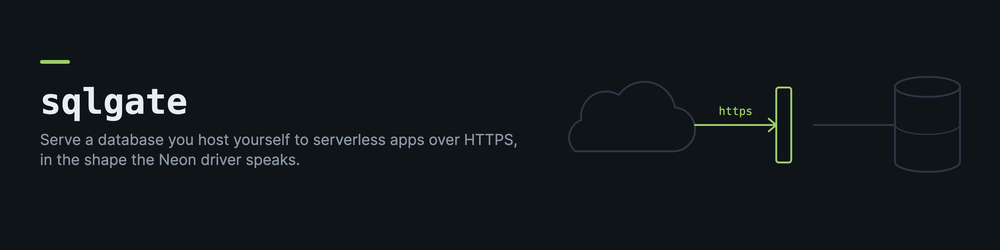

# sqlgate

sqlgate lets an app on Vercel, Netlify or Cloudflare use a Postgres or MySQL database that runs on your own machine.

A serverless function cannot open a database connection to a computer at home, and a database port should never be open to the internet. The Neon serverless driver sends each SQL statement as an HTTPS request instead of using the Postgres protocol. sqlgate answers those requests on your machine, behind a tunnel, so an app that already uses the Neon driver works against your own database with only a new connection string.

It also serves MySQL to Python apps through a small DB-API driver (in [clients/python](clients/python)), forwards Supabase style REST calls to PostgREST, and can start named jobs on your machine for a hosted app.

## What it does

- Answers `POST /sql` in the format the [Neon serverless driver](https://github.com/neondatabase/serverless) uses, including array mode and `sql.transaction` batches as real transactions
- Answers `POST /mysql` for the Python client, so SQLAlchemy apps keep their `mysql+pymysql` dialect
- Forwards `/rest/v1/*` to a local PostgREST, so `supabase-js` clients work unchanged
- Starts named jobs on the loopback with `POST /job` and reports what the job server answered
- Checks a token in constant time, with a second token for rotation without downtime
- Serves only the databases and roles listed in its config (each app connects as its own role)
- Limits requests per client address and logs every statement

## Quick start

You need Node 20 or newer and a database on the same machine.

```bash
npm install -g @drkostas/sqlgate
cp "$(npm root -g)/@drkostas/sqlgate/examples/sqlgate.example.json" sqlgate.json
```

Edit `sqlgate.json`. List each database and the roles an app may use. Create those roles in the database with only the rights the app needs (a role that only reads should only be able to read). The config never holds a secret itself. A secret is a reference to an environment variable, a file or a command, for example `{"command": ["security", "find-generic-password", "-s", "my-item", "-w"]}` for the macOS keychain.

Then start it with a token and check that it answers.

```bash
export SQLGATE_TOKEN="$(openssl rand -hex 32)"
sqlgate --config sqlgate.json
```

```bash
curl -s http://127.0.0.1:8102/healthz
```

sqlgate listens on the loopback only. Publish it with a tunnel ([Cloudflare Tunnel](https://developers.cloudflare.com/cloudflare-one/connections/connect-networks/) or similar) so the database port stays closed. There is a tunnel config in [examples/cloudflared.yml](examples/cloudflared.yml), and service files for systemd and launchd in [examples](examples).

## Connect an app

### Postgres with the Neon driver

Use a normal connection string with the role as the user and the sqlgate token as the password.

```
postgresql://shop_app:<token>@db.example.com/shop
```

The driver sends its requests to `https://api.example.com/sql`, because it replaces the first part of the host name with `api`. So the tunnel needs a hostname for `api.example.com` as well as `db.example.com` (the host in the connection string itself does not need to resolve). Keep that name one level below your domain. A free Cloudflare certificate covers `*.example.com` and not `*.db.example.com`, so a deeper name fails at the TLS handshake. No other change is needed in the app. If you prefer to name the endpoint yourself, set it in code.

```js
import { neon, neonConfig } from "@neondatabase/serverless";
neonConfig.fetchEndpoint = () => "https://db.example.com/sql";
const sql = neon(process.env.DATABASE_URL);
```

Drizzle's `neon-http` driver uses the same driver underneath, so it works the same way.

### MySQL from Python

Install the client and pass it to SQLAlchemy as the DB-API module.

```bash
pip install sqlgate-client
```

```python
import sqlalchemy as sa
import sqlgate_client

engine = sa.create_engine(
    "mysql+pymysql://blog_app:<token>@db.example.com/blog",
    module=sqlgate_client,
)
```

Requests go to `https://db.example.com/mysql`. Dates, decimals and bytes come back as the same Python types a local driver returns, and MySQL errors raise the same exception classes (a duplicate key raises `IntegrityError`).

### Supabase style REST

With `"rest": {"port": 3000}` in the config, requests to `/rest/v1/*` go to the PostgREST server on that port. Give `supabase-js` the sqlgate URL and your PostgREST JWT, and the row level security policies in the database still decide what each request can see.

## Jobs

Some work is too long for a serverless function, for example a sync that walks a whole table. A hosted app can ask sqlgate to start it on your machine instead.

```json
"jobs": {
  "rebuild_index": {
    "url": "http://127.0.0.1:8100/rebuild_index",
    "basicAuth": { "user": "admin", "password": { "env": "INDEX_JOB_PASSWORD" } }
  }
}
```

```bash
curl -X POST https://db.example.com/job \
  -H "x-gateway-token: $SQLGATE_TOKEN" -d '{"job":"rebuild_index"}'
```

The caller sends a job name, never a URL, and every job URL must be on the loopback. sqlgate waits up to three seconds for the job server's first answer. A 409 from the job server comes back as "already running", an error comes back as a failure with its reason, and silence means the job is running.

## One token per database

A gateway token opens every database and every job. To give each app only what it needs, put the
app's token on its database instead, and keep the gateway tokens empty or for yourself:

```json
"postgres": {
  "databases": {
    "shop": { "roles": ["shop_app"], "tokens": [{ "command": ["security", "find-generic-password", "-s", "sqlgate-shop", "-w"] }] },
    "demo": { "roles": ["demo_ro"], "tokens": [{ "env": "SQLGATE_DEMO_TOKEN" }] }
  }
},
"jobTokens": [{ "env": "SQLGATE_JOB_TOKEN" }]
```

A database's token opens that database only. `jobTokens` open `POST /job` only. A token for another database gets the same 401 as a wrong token, so it cannot find out which databases are served. Each list rotates the same way as the gateway tokens below.

## Reload without a gap

sqlgate holds its port in a main process and serves from a worker. Send the main process `SIGHUP`
after you change the config or upgrade the package: a new worker reads both from disk, and once it
listens the old worker stops taking connections, finishes the requests it has and exits, so no
request is refused on the way. A config that does not load is refused, and the running worker keeps
serving. `SIGTERM` lets the requests in flight finish (up to `shutdownGraceSeconds`, 10 by default)
and then exits. A process manager's own restart stops the old process before it starts the new one,
which leaves a short gap, so prefer `SIGHUP`:

```bash
kill -HUP "$(pgrep -f 'sqlgate.*--config')"     # or launchctl kill SIGHUP gui/$UID/<label>
```

Set `SQLGATE_NO_CLUSTER=1` to run without the worker (the drain on `SIGTERM` still applies).

## Rotate the token

Put the new token in the first token reference and the old one in the second. Move the apps to the new token, then clear the second. sqlgate reads the tokens again every minute, so nothing restarts. Tokens shorter than 24 characters are ignored.

## Configuration

See [examples/sqlgate.example.json](examples/sqlgate.example.json) for every option.

| Key | Default | Meaning |
|---|---|---|
| `listen.host`, `listen.port` | `127.0.0.1`, `8102` | Where sqlgate listens. A non-loopback host is refused unless `listen.allowNonLoopback` is true |
| `tokens` | at least one token somewhere | Secret references for the gateway tokens, which open every database and job |
| `jobTokens` | none | Secret references for tokens that open `POST /job` only |
| `clientIpHeader` | none | Header that carries the real client address behind a proxy (`cf-connecting-ip` for Cloudflare) |
| `rateLimit` | 240 per 60 s | Requests per client address, REST requests included. Only admitted requests count, and the first refusal of each burst is logged. A serverless app reaches the gateway from a few shared addresses, so size it for a burst of page loads rather than for one user |
| `maxBodyBytes` | 8 MB | Larger requests get a 413 |
| `healthDetails` | `false` | When true, `/healthz` also lists the served databases and jobs |
| `shutdownGraceSeconds` | `10` | How long a stopping worker may finish its requests on `SIGHUP` or `SIGTERM` |
| `postgres`, `mysql` | none | `host`, `port`, `databases` (each with `roles` and optional `tokens` that open it only) and optional `rolePasswords` |
| `rest` | none | `port` (and optional `host`) of a PostgREST server |
| `jobs` | none | Named jobs, each with a loopback `url` and optional `basicAuth` |

## Claude Code skill

```bash
npx @drkostas/sqlgate skill     # copies it to ~/.claude/skills/sqlgate
```

The skill gives Claude the procedure we used to move apps from a hosted database onto one at home. It covers the configuration, pointing each kind of driver at the gateway, proving the app really uses it, comparing responses byte for byte before switching a live gateway, swapping it with an automatic rollback, and backups. It ends with a table of the failures we met with how to check and fix each one.

## Limits

- `sql.transaction([...])` runs as one transaction (with the isolation level, read only and deferrable options the driver sends), but each request is its own transaction, so an interactive transaction across several requests is not possible. The MySQL side has no transactions at all, and every statement commits on its own.
- Neon's WebSocket mode (`Pool` and `Client` from the driver) is not supported, only the HTTP mode.
- The MySQL side has a Python client only.

## Security

sqlgate puts SQL behind a public address, so read [SECURITY.md](SECURITY.md) before you publish it.

## Development

```bash
npm install
npm test
```

The tests start their own throwaway Postgres and MySQL servers when the binaries are installed, and skip those parts when they are not. The Python client has its own tests in `clients/python`.

## License

MIT
